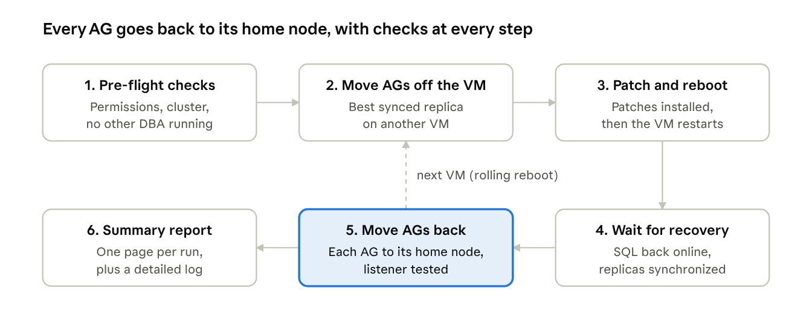

# AG Failover Tool – Leadership Overview

Last updated: Nov 27, 2026

## Summary

The AG Failover Tool turns our manual, server-by-server AG failovers during patching into a guided, checked and fully logged process. It moves SQL Server Always On availability groups off a VM before maintenance and puts them back afterwards, without data loss. It can also patch-reboot a whole cluster one VM at a time.

Every step is checked before and after it runs, and each run produces a plain-English summary of what moved where. The tool is built and documented, and is ready for testing in non-production.

## Why we built it

Patching AG servers today depends on a DBA failing each AG over by hand, in the right order, and remembering where each one belongs afterwards. That work happens in weekend maintenance windows across SQL Server 2016 to 2025 on Azure VMs.

The manual process carries four risks:

- **Wrong target.** Failing over to a replica that is not synchronized, not patched or missing a database can cause data loss or an outage.
- **AGs left in the wrong place.** After the window, an AG can stay on the wrong node until someone notices.
- **Hidden failures.** A timeout can look like a failure when the failover actually worked, or the reverse, and applications may not reach the new primary through the listener.
- **No record.** There is no consistent record of what moved where, for audit or for the next shift.

## What the tool does

The DBA runs one tool from a cluster VM and picks an option from a menu. There is nothing to install beyond the tool's two files.

| Option | What it does for us |
| --- | --- |
| 1. Before activity | Moves every AG off the VM being patched to the best healthy replica on another VM, and records where each AG was. |
| 2. After activity | Puts every AG back where it was before the maintenance. |
| 3. Health check | A read-only report on every AG and database, with a HEALTHY or ATTENTION verdict. |
| 4. Dry run | Runs every check and shows every command, without changing anything. |
| 5. Rolling reboot | Patch-reboots the whole cluster one VM at a time and rebalances the AGs at the end. VMs can be skipped if the window runs out, and an interrupted run resumes where it stopped. |
| 6. Rebalance | Moves AGs to their agreed home nodes from a simple list, even with no record of a previous run. |

## How a patch night works

For one VM, the DBA runs option 1, patches, then runs option 2. For the whole cluster, option 5 repeats steps 2 to 5 for each VM by itself.

If any check fails, the run stops and explains why. Nothing changes until the DBA decides.

## Safety built in

The tool only does planned failovers with no data loss. It never forces a failover. When a check fails, it stops and explains, rather than guessing.

| When | What it checks | What it prevents |
| --- | --- | --- |
| Before anything changes | Every server is reachable with the right permissions; no other DBA is running the tool on the same servers; the cluster can safely lose the VM. | Half-finished runs, two people working on the same AGs, taking the cluster down. |
| Before each failover | The target replica is synchronized, has every database, and is on the same or a newer SQL patch level. The tool also warns if writes would pause, or if long-running transactions would be rolled back. | Data loss, missing databases, moving to an unpatched server, surprise outages for applications. |
| During maintenance | The VM being patched can't automatically take an AG back while it is out of service. | AGs landing on a server mid-patch. |
| After each failover | The new primary really is primary (even if the command timed out), the replicas re-synchronize, and applications can connect through the AG listener. | Silent failures, and applications unable to connect after a "successful" failover. |

Every decision a DBA overrides is written to the log. Progress is saved after every step, so a closed window or a reboot never loses track of where the AGs belong.

## What leadership gets

Every run writes a one-page summary in plain English that can be forwarded as it is. It shows who ran it and when, an overall result (SUCCESS, PARTIAL or FAILED), and one line per AG:

- where it was before
- where it moved
- whether it moved back
- whether applications could connect afterwards
- any issue, with its reason

An illustrative example of the core of a summary (made-up names):

| AG | Original primary | Moved to | Returned | Listener | Result |
| --- | --- | --- | --- | --- | --- |
| AG\_Sales | SQLVM01 | SQLVM02 | Yes | OK | Success |
| AG\_HR | SQLVM01 | SQLVM03 | Yes | OK | Success |
| AG\_Finance | SQLVM01 | not moved | n/a | n/a | Skipped: target not synchronized |

For a whole-cluster rolling reboot, the summary also shows each VM's downtime in minutes, any VMs skipped, and the SQL patch level before and after. Behind each summary is a detailed technical log, which records the likely root cause of any error.

## Benefits

- **Lower risk.** The same safety checks run every time, whoever is on shift and however late the window runs.
- **Less manual work.** The tool finds the AGs, picks targets, moves them and puts them back, instead of a DBA doing each step by hand. A whole cluster can be patch-rebooted in one guided run.
- **Consistent results.** The AGs always end up back on their agreed home nodes, with automatic failover switched back on.
- **Audit trail.** Every run leaves a summary and a detailed log of what changed, who approved each override, and why anything failed.
- **Faster troubleshooting.** Errors come with a likely root cause and a suggested fix.

We will measure the time saved per patch window during the pilot rather than estimate it now.

## Status and next steps

The tool is built and documented, and sits in our team's DBA repository with a user guide and automated tests. It has not yet been run against a live cluster. The proposed rollout:

1. **Non-production testing.** Dry runs first, then live runs on a non-production AG cluster, covering single-VM drains, failback, a rolling reboot and the failure cases.
2. **Production pilot.** Use it on one production cluster for a patch window, with a DBA watching every step, and measure the time taken against the manual process.
3. **Team rollout.** A short walkthrough for the DBA team, then use it for all AG patching.
4. **Automation (next phase).** Let our patching platform (Tanium) call the tool before and after patching with no prompts, and keep summaries on a shared folder.

## Limits and open risks

- **Not a disaster-recovery tool.** It does planned failovers only. A real DR event, where data loss may be accepted, stays with our DR runbook.
- **Some AG types are reported, not moved.** These are AGs with only asynchronous replicas (such as DR-site copies), AGs without a Windows cluster, and distributed AGs. The DBA handles them by hand.
- **It reboots but does not patch.** The rolling reboot assumes the patches are already installed (by Tanium today).
- **Permissions.** The rolling reboot needs local admin rights on the VMs, or an admin credential entered at the start.
- **Not yet proven live.** Until non-production testing is complete, it should not be used on production clusters.
