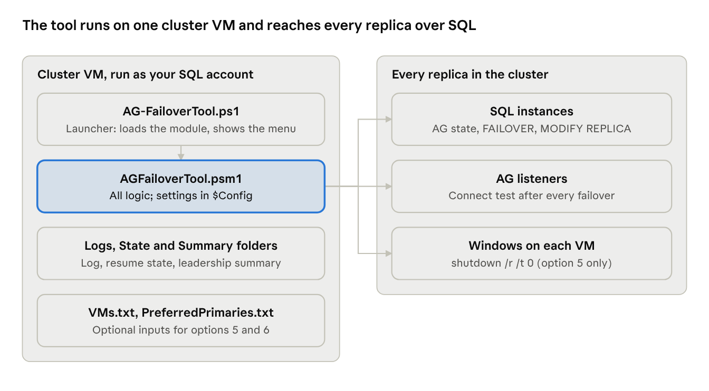
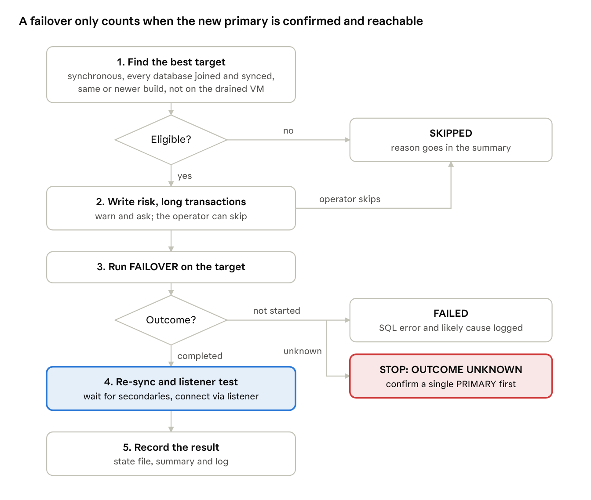

# AG Failover Tool – SOP and Technical Guide

Last updated: Nov 27, 2026

## 1. Purpose and scope

This is the standard procedure for moving SQL Server Always On AGs during planned maintenance with the AG Failover Tool (v1.4). It is also the handover (KT) document for DBAs who support or change the tool. The code lives in [DBA.Queries / automation/AG-Failover](https://github.com/ManikyaSG/DBA.Queries/tree/main/automation/AG-Failover).

**In scope:** planned, no-data-loss failovers of WSFC-based AGs on SQL Server 2016–2025 running on Azure VMs.

**Out of scope:** disaster recovery (forced failover), async-only AGs, clusterless (`NONE` / `EXTERNAL`) AGs and distributed AGs.

| Situation | Use | SOP |
| --- | --- | --- |
| Patch or reboot one VM | Option 1 before, option 2 after | A |
| Patch-reboot every VM in a cluster | Option 5 | B |
| AGs are on the wrong nodes, with no state file | Option 6 | C |
| Check AG health at any time | Option 3 | D |
| First run in a new environment, or after updating the tool | Option 4 (dry run), then the real option | – |

## 2. Architecture



The tool is a PowerShell launcher plus one module, run on a cluster VM. It connects with Windows integrated security as the operator's account (`Application Name=AGFailoverTool`), through .NET `System.Data.SqlClient`. It installs nothing on the replicas and keeps no agent or service running. Everything it writes stays in its own folder.

## 3. Prerequisites and one-time setup

Do this once per cluster, on the VM you will run the tool from.

- [ ] Windows PowerShell 5.1 or PowerShell 7 on that VM. No SqlServer or dbatools module is needed.
- [ ] Your SQL login has `VIEW SERVER STATE` and `ALTER ANY AVAILABILITY GROUP` (or sysadmin) on every replica.
- [ ] The VM reaches every replica on the SQL port, and every AG listener (`Test-NetConnection <server> -Port 1433`).
- [ ] For a rolling reboot (option 5) only: your account is local admin on every VM, or you have an admin account to enter, with WinRM enabled on the VMs.
- [ ] Copy `AG-FailoverTool.ps1`, `AGFailoverTool.psm1` and the `Tests` folder from the repo into one folder, for example `D:\DBA\AGFailoverTool`. The `.ps1` and `.psm1` must sit together.
- [ ] If the files came from a download or an email, unblock them: `Get-ChildItem D:\DBA\AGFailoverTool -Recurse | Unblock-File`
- [ ] Optional: create `VMs.txt` (reboot order for option 5) and `PreferredPrimaries.txt` (home node per AG, for option 6). Section 9 shows their formats.
- [ ] Run once with option 4 (dry run) to confirm connectivity and permissions.

**Starting the tool:** RDP to the VM. Open PowerShell with **Run as different user**, using your SQL account. Then run:

```powershell
cd D:\DBA\AGFailoverTool
powershell.exe -ExecutionPolicy Bypass -File .\AG-FailoverTool.ps1
```

## 4. SOP A – Patch or reboot one VM (options 1 and 2)

**Before the activity (option 1):**

1. Start the tool and choose **1**.
2. Enter the VM name, for example `SQLVM01`. If the VM only has named instances, enter one of them (`SQLVM01\INST1`); the tool finds the others itself.
3. The tool lists every instance on the VM and prints the **plan**: AG, instance, original primary, planned target, write risk, and any skip reason.
4. **Pre-flight** runs: permissions on every replica, no other operator active, the cluster nodes and witness UP, and quorum safe without this VM. Any problem gives **Override / Cancel**. Cancel, fix the problem and start again, unless you accept the risk.
5. Type `YES` (capitals). The original primaries are saved to `State\AGState_<VM>_<time>.json` **before** anything changes.
6. For each AG the tool re-checks the target, asks about any write risk or long transactions, fails over, waits for re-sync and tests the listener.
7. It then sets the VM's AUTOMATIC replicas to MANUAL failover for the activity, and writes `Summary\AG_Failover_Summary_<VM>_<time>.txt`.
8. **Gate:** do not patch or reboot if any AG shows `FAILED`, `SKIPPED` or `UNKNOWN`. Those AGs are still on the VM or in an unknown state. Resolve them first (section 11).

**The activity:** patch or reboot the VM as usual (Tanium or by hand). Wait until SQL is back up.

**After the activity (option 2):**

1. Choose **2** and pick the activity from the numbered list.
2. The plan shows each AG's current primary, where it returns to, and the action (`FAILBACK`, `ALREADY_PRIMARY` or `BLOCKED` with the reason). A version mismatch blocks failback if the original node is on a lower build.
3. If databases are suspended on the original node, answer the resume prompt (section 8).
4. Pre-flight runs again. Type `YES`.
5. AGs return, listeners are tested, and AUTOMATIC failover is restored. The failback section is appended to the same summary file.
6. **Close-out:** the overall result should read SUCCESS. Run option 3 for a final health check, and attach the summary file to the change ticket.

## 5. SOP B – Rolling reboot of the whole cluster (option 5)

Option 5 only reboots. Patches must already be installed (Tanium).

1. Run the tool **on one of the cluster VMs** and choose **5**.
2. The tool finds the cluster nodes, or reads `VMs.txt` if present, and finds the SQL instances on them. It takes a **pre-snapshot** of every AG primary and prints the reboot order. The VM you are on is always **last**.
3. Pre-flight runs on every instance.
4. Enter the **maintenance window end** (`HH:mm`, 24-hour), or leave it blank for no limit.
5. Type `YES`, then choose the reboot account: **U** for your account (`shutdown /r /t 0 /m \\VM`), or **C** to enter an admin credential (`shutdown /r /t 0` through WinRM).
6. Before each VM, choose one of these:

   | Key | Action |
   | --- | --- |
   | C | Continue with this VM. |
   | S | Skip this VM; it is not rebooted. |
   | R | Run this and all remaining VMs without asking. Prompts come back once the window has ended. |
   | A | Skip all remaining VMs and go to the final rebalance. |
   | Q | Quit. Run option 5 later to resume. |
7. For each VM the tool runs these steps:
   - checks the other nodes, the witness and quorum
   - drains the VM (the same checks as option 1) and sets its replicas to MANUAL
   - reboots it and confirms the reboot happened, because the SQL start time changes
   - waits for SQL to come back and the replicas to re-sync
   - returns the VM's AGs and restores AUTOMATIC failover

   If an AG can't be moved, the VM is **not** rebooted. You choose: bring the moved AGs back and skip the VM, or quit.
8. At **your VM** the tool drains it and stops. Reboot it yourself with `shutdown /r /t 0`. Log back in, start the tool, choose **5**, then **R** (Resume).
9. The tool returns your VM's AGs, **rebalances every AG to the pre-snapshot**, and writes the final summary.
10. **Close-out:** check that every AG shows `BALANCED` in `Summary\Rolling_Reboot_Summary_<cluster>_<time>.txt`, run option 3, and attach the summary to the change ticket.

Progress is saved after every step. After a quit, an error, a closed window or a reboot, choose option 5 and then **R** to continue where it stopped.

## 6. SOP C and D – Rebalance (option 6) and health check (option 3)

**SOP C – Rebalance to preferred primaries.** Use this after a manual or unplanned failover, or when the state file is lost.

1. Choose **6**. If `PreferredPrimaries.txt` doesn't exist, choose **G** and enter any instance in the cluster. The file is written from the **current** layout.
2. Edit the file so each AG names its home instance, and commit the change to the repo so the team shares one list.
3. Choose **6** again. The plan shows each AG as `MOVE`, `ALREADY_PRIMARY` or `BLOCKED` (the AG or instance wasn't found). Pre-flight runs; type `YES`.
4. Every move gets the full set of checks: target readiness, build, listener test. The result is written to `Summary\AG_Rebalance_<time>.txt`.

**SOP D – Health check.** This is read-only and can be run at any time.

1. Choose **3** and enter any instance in the cluster.
2. For each AG you get:
   - replicas: role, mode and connection state, plus each replica's SQL build
   - databases: sync state, suspension, queues and joined status
   - a **HEALTHY** or **ATTENTION** verdict, with the reasons
3. The report is saved as `Summary\AG_HealthCheck_<instance>_<time>.txt`. Run it before and after every activity.

## 7. How each failover is decided

After pre-flight passes, every AG goes through the same steps in `Move-AGToBestTarget` and `Invoke-ReturnAG`.



**Target ranking.** Among the eligible replicas, the tool prefers the AUTOMATIC failover partner, then the smallest log send plus redo queue. It waits up to `SyncWaitSec` (180 s) when the only problem is a replica still catching up. A suspended database, an unjoined database, async commit or a lower build is never waited for.

**Outcome check.** After a FAILOVER error, the tool asks the target and the old primary for their roles for up to `RoleVerifyWaitSec` (60 s). NOT STARTED needs two consistent readings, so a failover still in progress isn't mistaken for one that never started.

**During the activity.** Once the drain is done, the drained VM's AUTOMATIC replicas are set to MANUAL. Failback sets them back to AUTOMATIC.

## 8. Prompts and the recommended answer

| Prompt | Where | Recommended answer |
| --- | --- | --- |
| `Type YES to continue` | All options | `YES` in capitals to go ahead. Anything else cancels with no changes. |
| `[O]verride … / [C]ancel` | Pre-flight | **C**, then fix the listed problem. Override only with your lead's agreement; it is logged. |
| `[C]ontinue with this failover anyway / [S]kip this AG` | Write risk (`REQUIRED_SYNCHRONIZED_SECONDARIES_TO_COMMIT`) | **S**, unless the setting was set to 0 for the activity, or a pause in writes is accepted. |
| `[C]ontinue / [R]e-check / [S]kip` | Long open transactions | **R** after the job finishes. **C** if the rollback time is acceptable. |
| `Resume data movement …? (Y/N)` | Options 2 and 5 | **Y** only when you know why it was suspended and that cause is fixed. Otherwise **N**, then run option 3. |
| `[R]esume / [N]ew run / [C]ancel` | Option 5 start | **R** to continue an unfinished run. **N** abandons it. |
| `[U]se … / [C]redential` | Option 5 reboot account | **U** if you are local admin on the VMs, otherwise **C**. |
| `C / S / R / A / Q` | Option 5, before each VM | See SOP B. Use **S** or **A** when the window is ending. |
| `[S]kip / [O]verride / [Q]uit` | Option 5 pre-reboot checks | **S** or **Q**. Override only if you understand the quorum or outage risk. |
| `[B]ring the moved AGs back and skip / [Q]uit` | Option 5, drain incomplete | **B** keeps the VM healthy and unpatched. **Q** stops so you can investigate. |
| `[R]esend / [W]ait / [B]ring back / [Q]uit` | Option 5, VM didn't go down | **R** once. If it still doesn't go down, check reboot rights (section 11). |
| `[W]ait / [C]ontinue / [Q]uit` | Option 5, VM or re-sync slow | **W** while Windows updates are still applying (check the Azure serial console or boot diagnostics). |
| `[G]enerate / [C]ancel` | Option 6, no list file | **G**, then edit the file before rebalancing. |

## 9. Files and result codes

**Output files** are created next to the launcher. Files from a dry run end in `_DRYRUN`.

| Folder | File | Contents | Keep |
| --- | --- | --- | --- |
| `Summary\` | `AG_Failover_Summary_<VM>_<time>.txt` | Options 1 and 2: each AG's original primary, new primary, result, time, listener check, automatic failover during the activity, and issues. | Attach to the change ticket. |
| `Summary\` | `Rolling_Reboot_Summary_<cluster>_<time>.txt` | Option 5: the layout before, progress per VM (minutes down), moves and returns, the final layout (BALANCED / NOT\_BALANCED), SQL builds before and after. Rewritten after every step. | Attach to the change ticket. |
| `Summary\` | `AG_Rebalance_<time>.txt` / `AG_HealthCheck_<instance>_<time>.txt` | Options 6 and 3. | As needed. |
| `Logs\` | `AGFailoverTool_<time>.txt` | Every step and every T-SQL statement, plus an ERROR DETAIL block for each failure. | Until the change is closed. |
| `State\` | `AGState_<VM>_<time>.json`, `Rolling_<cluster>_<time>.json` (+ `.bak`) | What options 2 and 5 resume from. | **Never delete while an activity is open.** |

**Input files** (optional, next to the launcher). Lines starting with `#` are comments; put a comment on its own line.

```text
# VMs.txt - reboot order for option 5; VM\INSTANCE adds a named instance
SQLVM02
SQLVM03
SQLVM02\INST2
```

```text
# PreferredPrimaries.txt - home node per AG for option 6
AG_Sales   = SQLVM01
AG_Finance = SQLVM02\INST2
```

**Result codes**

| Code | Meaning | Action |
| --- | --- | --- |
| `FAILED_OVER` / `FAILED_BACK` / `MOVED` / `RETURNED` | Done and verified. | None. |
| `ALREADY_PRIMARY` / `NOT_PRIMARY_HERE` | Already in place, or the VM is only a secondary for this AG. | None. |
| `DRYRUN` | Dry run only. | None. |
| `SKIPPED` | Not moved, with a stated reason (no eligible target, or the operator chose skip). | Fix the reason before rebooting. |
| `BLOCKED` | A check failed (version mismatch, replica not ready, AG not found). | Fix it, then rerun. |
| `FAILED` | The failover didn't happen; the log has the SQL error and the likely cause. | Section 11. |
| `UNKNOWN` | The tool couldn't confirm which replica is primary. | **Stop.** Confirm a single PRIMARY first. |
| `NOT_SYNCED` | Option 5: the replica wasn't synchronized after the reboot. The final rebalance retries it. | Watch the final layout. |
| `BALANCED` / `NOT_BALANCED` | Option 5 final layout compared with the pre-snapshot. | Rebalance with option 6 if needed. |

## 10. Settings reference

The settings are in `$Config` at the top of `AGFailoverTool.psm1`. Change them in the repo, not on one VM, so every copy behaves the same.

| Setting | Default | Meaning |
| --- | --- | --- |
| `ConnectTimeoutSec` / `QueryTimeoutSec` | 15 / 120 | SQL connection and query timeouts (seconds). |
| `FailoverTimeoutSec` | 600 | Timeout for `ALTER AVAILABILITY GROUP … FAILOVER`. |
| `SyncWaitSec` | 180 | How long to wait for a target to become synchronized. |
| `RoleVerifyWaitSec` | 60 | How long to confirm the new role, and to work out the outcome after an error. |
| `PostFailoverSyncWaitSec` | 120 | How long to wait for secondaries to re-sync after a failover. |
| `ListenerWaitSec` | 90 | How long to wait for each listener to reach the new primary. |
| `LongTranWarnMin` | 5 | Transactions open longer than this (minutes) are listed before a failover. |
| `ConcurrencyWindowMin` | 15 | Another operator's tool session active within this window (minutes) blocks a run. |
| `SqlRetryCount` / `SqlRetryDelaySec` | 2 / 3 | Retries for transient errors on read-only queries. `FAILOVER` and `ALTER` are never retried. |
| `QueueWarnKB` | 102400 | Warn when a target has more than this queued (100 MB). |
| `PreferredPrimariesFile` | `PreferredPrimaries.txt` | The list file option 6 reads. |
| `RebootDownTimeoutSec` | 600 | Option 5: how long a VM has to go down after the reboot command. |
| `RebootUpTimeoutSec` | 3600 | Option 5: how long SQL has to come back after the reboot. |
| `RebootSyncWaitSec` | 1800 | Option 5: how long the rebooted VM's replicas have to re-sync. |
| `RebootPollSec` / `PollIntervalSec` | 15 / 5 | Polling intervals (seconds). |

## 11. Troubleshooting and escalation

Start with the **ERROR DETAIL** block in `Logs\AGFailoverTool_<time>.txt`. It holds:

- the step, the AG and the server
- the exact T-SQL that ran
- the SQL error number, severity and state
- the exception chain and the script line
- a **Likely root cause / fix** line
- a snapshot of the AG at the moment of failure

| Symptom | Likely cause | Fix |
| --- | --- | --- |
| `Login failed (18456)` | PowerShell isn't running as your SQL account. | Restart it with *Run as different user*. |
| Network error (53, 10060, 10061, 40) | Name resolution, firewall or NSG on the SQL port, or the SQL service is down. | `Test-NetConnection <server> -Port 1433`, then check the service. |
| Permission denied (229, 297, 300, 15247) | `VIEW SERVER STATE` or `ALTER ANY AVAILABILITY GROUP` is missing. | Grant them on every replica. |
| Error 41142 | Target not synchronized or not failover-ready. | Option 3; resume or wait for sync. |
| Error 41131 | The cluster couldn't bring the AG online on the target. | Check `NT AUTHORITY\SYSTEM` permissions on the target, the cluster service, and `Get-ClusterLog`. |
| Error 35250 | The secondary isn't connected. | Check the mirroring endpoint (started, port open, `CONNECT` granted). |
| Error 19405 | The cluster service is unavailable or quorum is lost. | Check Failover Cluster Manager and the quorum. |
| **OUTCOME UNKNOWN** | The failover errored and the role couldn't be confirmed. | Don't retry or reboot. Confirm a single PRIMARY (option 3 or Failover Cluster Manager), then read the cluster log and the SQL error logs. |
| `NOT JOINED` | A database was added on the primary but never joined on that replica. | Seed it, or restore it `WITH NORECOVERY` and run `ALTER DATABASE … SET HADR AVAILABILITY GROUP = …`. |
| `lower than the primary's` | The target isn't patched yet. | Patch the target first. |
| `STOP ACCEPTING WRITES` | `REQUIRED_SYNCHRONIZED_SECONDARIES_TO_COMMIT` can't be met while the VM is out. | Set it to 0 for the activity and back afterwards, or skip the AG. |
| `Listener check FAILED` | The listener doesn't reach the new primary. | Azure: check the ILB health probe and the cluster IP `ProbePort`, or the DNN resource, plus DNS. |
| `another AGFailoverTool is active` | Another operator is working on the same replicas. | Agree with them before continuing. |
| `shutdown … exit code 5` | Not local admin on the VM. | Use **C** at the start to enter an admin credential. |
| `shutdown … exit code 53` | The name didn't resolve, or remote shutdown is blocked. | Allow the *Remote Shutdown* and *WMI* firewall rules. |
| A replica still MANUAL after failback | AUTOMATIC couldn't be restored. | Run the `MODIFY REPLICA … FAILOVER_MODE = AUTOMATIC` printed in the log, on the primary. |

**Escalation:** for an `UNKNOWN` result, a cluster or quorum error, or an AG offline after failover, stop and engage the on-call senior DBA. Attach the log file, the state file and the summary.

## 12. KT for maintainers

**Code map.** `AG-FailoverTool.ps1` only loads the module and calls `Start-AGFailoverTool`. All the logic is in `AGFailoverTool.psm1`:

| Area | Key functions | Notes |
| --- | --- | --- |
| Entry and menu | `Start-AGFailoverTool`, `Initialize-AGFailoverTool` | Initialize creates `Logs\`, `State\` and `Summary\` under the base path. |
| SQL access | `Invoke-Sql`, `Test-TransientSqlError`, `Invoke-NoRetry` | The only path to SQL (integrated security, `Application Name=AGFailoverTool`). Read-only queries are retried; `-NonQuery` statements never are. |
| Logging and errors | `Write-Log`, `Write-ErrorDetail`, `Get-RootCauseHint` | Root-cause hints come from SQL error numbers, then from message text. |
| AG state | `Get-ServerInfo`, `Get-AGList`, `Get-AGReplicas`, `Get-AGDatabases`, `Get-AGPrimary`, `Get-LocalRole` | `Get-AGDatabases` returns every AG database × replica, so unjoined databases show up. Run it on the primary. |
| Target selection | `Get-ReplicaReadiness`, `Find-FailoverTarget` | Readiness rules and ranking: section 7. |
| Failover | `Invoke-AGFailover`, `Resolve-FailoverOutcome`, `Get-FailResult` | After an error, outcome is COMPLETED / NOT\_STARTED / UNKNOWN; UNKNOWN throws a message starting `OUTCOME UNKNOWN`. |
| Safety checks | `Invoke-PreChecks` (`Test-Preflight`, `Get-OtherToolSessions`, `Get-ClusterIssues`), `Get-CommitRisk`, `Confirm-LongTransactions` | One Override/Cancel prompt for all pre-flight problems. |
| After failover | `Wait-AGResync`, `Test-AGListener`, `Set-ReplicasManual`, `Restore-FailoverModes`, `Get-AutoFailoverStatus` | The listener test uses `MultiSubnetFailover=True;Pooling=False`. |
| Shared drain step | `Move-AGToBestTarget` | Used by options 1 and 5, so both apply the same checks. |
| State | `Save-State`, `Read-StateFile` | Writes go to `.tmp`, then an atomic replace keeps a `.bak`. |
| Options | `Invoke-DrainNode` (1), `Invoke-Failback` (2), `Invoke-HealthCheck` (3), `Invoke-RollingReboot` (5), `Invoke-PreferredRebalance` (6) | Option 5 internals: `New-RollingRun`, `Invoke-RollingVM`, `Invoke-VMReboot`, `Wait-VMOnline`, `Wait-VMReplicasSynced`, `Invoke-RollingFinal`. |

**Tests.** `Tests\AGFailoverTool.Tests.ps1` holds about 30 Pester 5 tests, with every SQL call mocked, so no server is needed. They cover:

- target selection: unjoined databases, async replicas, lower builds, excluded VMs
- the failover outcome after an error: completed, not started, unknown
- commit-requirement risk, quorum loss and automatic-failover status
- the shared drain step
- damaged state files and the preferred-primaries file format
- which SQL errors count as transient

```powershell
Install-Module Pester -MinimumVersion 5.0 -Scope CurrentUser -Force -SkipPublisherCheck   # once
Invoke-Pester .\Tests -Output Detailed
```

**Changing the tool:**

1. Change `AGFailoverTool.psm1` in the repo, and bump `ToolVersion` in `$Config`.
2. Add or update a Pester test for the behaviour you changed, and run `Invoke-Pester .\Tests`.
3. Dry-run (option 4) on a non-production cluster, then do a live run there.
4. Update the user guide (`AG-FailoverTool-Guide.md`) and this document.
5. Commit to `main`, and replace both files on the VMs together.

**Rules to keep:** never retry a `FAILOVER` or `ALTER`; save the state file before the first change; treat an unconfirmed outcome as UNKNOWN, never as success; check every failover target the same way through `Find-FailoverTarget`.

## 13. Limits

- **No forced (data-loss) failover.** Real DR follows the DR runbook.
- **Async-only AGs** can't take a planned failover. They are reported as `SKIPPED`; handle them by hand.
- **`CLUSTER_TYPE = NONE` / `EXTERNAL` AGs and distributed AGs** are reported and not moved. In option 5 you are warned that they will be offline during the reboot.
- **No patching.** Option 5 only reboots; the patches must already be installed.
- **Prompts are required.** Unattended runs (for example, called from Tanium) are planned but not built yet.
- **One folder per VM.** State files live next to the tool on the VM where it ran, so run option 2 on the same VM as option 1.
