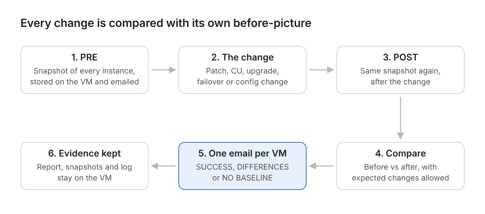

# SQL Server PRE / POST Change Check – Leadership Overview

Last updated: Nov 27, 2026 · Version 1.0.0

## Summary

The PRE / POST Change Check gives every SQL Server change the same before-and-after proof. Before a change (patching, CU, upgrade, failover, configuration), a DBA runs it once and it takes a full health snapshot of every SQL instance on the VM. After the change, it runs again, compares the two and emails one clear verdict per VM: **SUCCESS**, **DIFFERENCES** or **NO BASELINE**.

It is one double-click on the VM, needs nothing installed, and runs under the DBA's own account. The team uses it today for patch windows and health checks.

## Why we built it

Pre- and post-change checks used to be manual: a DBA ran a set of queries before and after, took screenshots and compared them by eye, instance by instance. That carries four risks:

- **Missed differences.** A setting, job, login, AG role or listener that changed during the window is easy to overlook when comparing by eye, especially at night and across many instances.
- **Inconsistent checks.** What was checked depended on who was on shift and how much time was left in the window.
- **Late detection.** Problems such as a job left disabled, an AG left on the wrong node or a database not back online were often found later, by users or by monitoring.
- **No evidence.** There was no consistent record of the state before and after a change for the change ticket, audit or the next shift.

## What the tool does

The DBA logs on to the VM, double-clicks one file and picks an option:

| Option | What it does for us |
| --- | --- |
| 1. PRE | Before the change: takes a full snapshot of every SQL instance on the VM, stores it on the VM and emails a "PRE captured" report as the baseline. |
| 2. POST | After the change: takes the same snapshot, compares it with the PRE of the same change ticket and emails the verdict. |
| 3. HEALTH | At any time: a health report for every instance with an OK, WARNING or CRITICAL verdict. Nothing is stored. |

One run covers every instance on the VM, and produces **one report and one email per VM**.

## How a change window works

The comparison knows the difference between what a change is *meant* to change and what it is not:

- **Expected changes** are listed for the record and are not failures. For example, a new SQL build or CU, and the restart time after patching.
- **Unexpected differences** are flagged with a before → after table. For example, a setting, database option, job, login, service account, AG role, listener IP or disk size.
- **New problems** are problems that exist after the change but not before. They are listed separately from problems that were already there.

## What is checked

Each snapshot covers, for every instance:

- the instance, its build and its services
- server settings and trace flags
- every database's state and options, and recent backups
- Always On replicas, listeners and database synchronization
- the Windows cluster and quorum
- disks and database files
- Agent jobs and recent job failures
- logins and server roles
- linked servers, endpoints, certificates and Extended Events sessions
- SSIS, SSRS and SSAS where they are installed
- severe error log entries from the last 24 hours

Small movements are tolerated so the result stays meaningful. A file or database size change is flagged only above 10 % and 512 MB, and a disk free-space change only above 5 % of the disk. Values that always move, such as backup times, CPU and queue sizes, are not compared.

## What leadership gets

One email per VM, with the verdict in the subject line and the full report attached:

| Email subject | Meaning | Importance |
| --- | --- | --- |
| `[POST SUCCESS]` | The change left everything as it was, apart from the expected changes. | Normal |
| `[POST DIFFERENCES]` | Something changed that should not have, or a new problem appeared. Every difference is listed before → after. | High |
| `[POST NO BASELINE]` | No PRE was taken for this change, so nothing could be compared. The current state is reported. | High |
| `[POST INCOMPLETE]` | An instance could not be checked at all (and nothing else was wrong). | High |
| `[PRE CAPTURED]` | The baseline before the change. | Normal |
| `[OK]` / `[WARNING]` / `[CRITICAL]` | Result of a HEALTH run. | High for CRITICAL |

The email opens with a one-line verdict and a summary table, with one row per instance. An illustrative example (made-up names):

| Instance | Checked as | Outcome | Unexpected | New problems | Expected |
| --- | --- | --- | --- | --- | --- |
| SQLVM01 | DOMAIN\dba.one | SUCCESS - no differences | 0 | 0 | 3 |
| SQLVM01\INST2 | DOMAIN\dba.one | DIFFERENCES FOUND | 1 | 0 | 3 |

Each instance's section then shows exactly what differed, for example *Agent jobs / NightlyETL / enabled: 1 → 0*. Every email shows the tool's version in its footer.

The report, the PRE and POST snapshots and the run log stay on the VM as evidence for the change ticket. They are kept for 48 hours after the POST; a PRE still waiting for its POST is kept for 7 days.

## Controls and safety

- **Read-only checks.** The checks only read from SQL Server. The one exception is Database Mail: if it is switched off or not set up on an instance, the tool can switch it on and run the team's standard Database Mail setup script so the report can be emailed. This can be turned off.
- **Runs as the DBA's own account.** The DBA logs on to the VM with the shared admin account as usual, then enters their own Windows account. The checks run as that account, so SQL Server's own permissions and audit apply. Each instance in the report shows which account checked it. If the DBA's account cannot reach an instance, that instance is checked with the logged-on admin account instead, and the report says so.
- **Nothing installed, no central connectivity.** It is a script and a SQL file in a folder on the VM. It connects only to the SQL instances on that VM and any it is configured to include. No agent, service or central server is involved.
- **Data stays on the VM.** Snapshots, reports and logs are kept in the tool's folder on the VM and cleaned up automatically. The only thing that leaves the VM is the email to the DBA team.
- **One sender.** Every email is sent from a single no-reply address, not from the server's own mail account.
- **No duplicate emails.** The same report is never emailed twice in one run.

## Benefits

- **Fewer missed issues.** Every setting and object in scope is compared, every time, on every instance.
- **Consistent checks.** The same checks run whoever is on shift and whatever the time.
- **Faster sign-off.** The subject line gives the verdict, so a clean change can be closed straight away and a problem gets attention at once.
- **Evidence for every change.** A before-and-after report linked to the change ticket.
- **Less manual work.** One run covers every instance on the VM, instead of queries and screenshots per instance.

We will measure the time saved per change window as the new version is rolled out, rather than estimate it now.

## Status and next steps

The tool is in use by the DBA team. Version 1.0.0 (November 2026) adds:

- one window for the whole run
- settings kept in a separate file on each VM, so updates never overwrite them
- the version shown in every report
- one question about the baseline asked at the start of POST, instead of during the run

Proposed next steps, each to be agreed separately:

1. **Roll out 1.0.0** to all SQL VMs after a check on one non-production VM.
2. **Clearer verdict:** GO, REVIEW or NO-GO in the subject line, by severity.
3. **Confirm the patch landed:** compare the build after patching with the expected build.
4. **Readiness wait:** after a reboot, POST waits until databases are online and AGs are synchronized, so it doesn't report a server that is still recovering.
5. **More checks:** before the change, a pending reboot, low free space, long-running transactions and AG queues; after it, new memory dumps and upgrade errors in the error log.
6. **Known differences:** an agreed list of accepted differences, each with a reason and an expiry date, so they stop being reported.
7. **Automation:** our patching platform (Tanium) triggers PRE and POST on each VM, so they don't depend on someone remembering to run them.

## Limits

- **One VM per run.** Each VM is checked separately and sends its own email; there is no single cross-estate view (that would need central connectivity, which is not approved).
- **SQL Server on VMs only.** Azure SQL Database and Managed Instance are not covered.
- **It compares, it does not fix.** It reports differences and problems; a DBA decides and acts.
- **It needs a PRE.** Without a PRE for the change, POST can only report the current state.
- **Timing matters.** POST should run after services are up and AGs are synchronized again, otherwise a server that is still recovering is reported as a difference.
