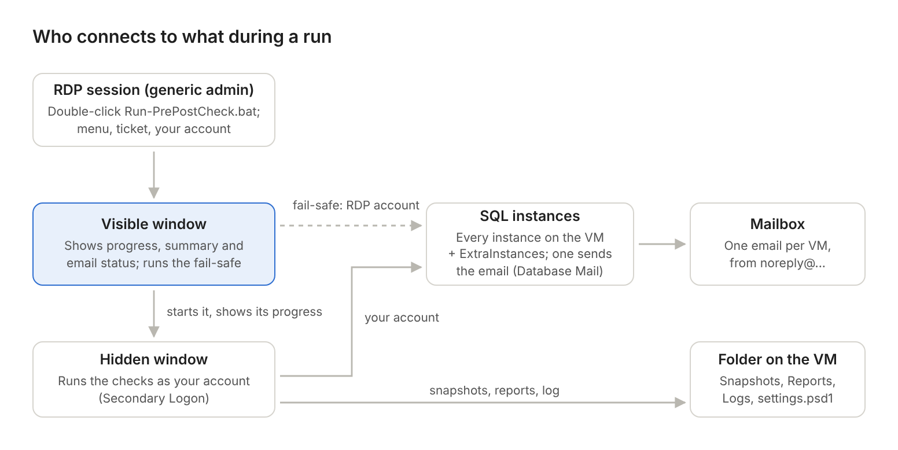
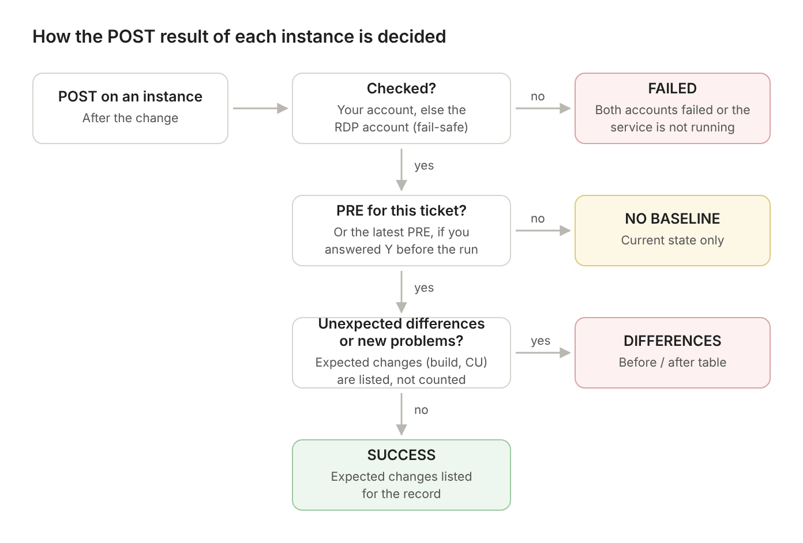

# PRE / POST Change Check – SOP and Technical Guide

Last updated: Nov 27, 2026 · Version 1.0.0

## 1. Purpose and scope

This is the standard procedure for checking SQL Server before and after a change with the PRE / POST Change Check (v1.0.0). It is also the handover (KT) document for DBAs who support or change the tool. The code lives in [DBA.Queries / automation/pre-post-check](https://github.com/ManikyaSG/DBA.Queries/tree/main/automation/pre-post-check); the [README](../README.md) has the full list of what is compared.

**In scope:** SQL Server 2016–2025 on Windows VMs (including Always On AGs and FCIs), plus SSIS, SSRS and SSAS where they are installed.

**Out of scope:** Azure SQL Database, Azure SQL Managed Instance and SQL Server on Linux. The tool doesn't fix anything; it reports.

| Situation | Use | SOP |
| --- | --- | --- |
| Any planned change on a SQL VM (patch, CU, upgrade, failover test, config change) | PRE before, POST after, same ticket | A |
| Health check at any time (daily check, after an incident, before handover) | HEALTH | B |
| Put the tool on a new VM, or update it on a VM | Copy the files, then `settings.psd1` | C |

## 2. How it works

- **Accounts.** You RDP to the VM with the generic admin account and double-click `Run-PrePostCheck.bat`. The script asks for **your** Windows account (the one you use for SSMS "Run as different user").
- **Windows.** The script starts itself again as your account in a **hidden** window, through the Windows Secondary Logon service. That hidden window does the work: it connects to every SQL instance with Windows authentication, saves the snapshot, compares and sends the email. The window you started from shows its progress line by line, then the summary.
- **Fail-safe.** If your account can't log in to an instance, or lacks `VIEW SERVER STATE` there, that instance is handed back and checked by the visible window as the generic admin account. If the hidden window can't start at all, the visible window does the whole run, using your account first.
- **What it reads.** `HC_Snapshot.sql` runs on each instance and returns about 30 sections of data (instance, services, settings, databases, AGs, cluster, disks, files, jobs, security, SSIS/SSRS…). The script adds the SSIS/SSRS/SSAS Windows services of the VM.
- **What it writes.** All files go in the tool's folder on the VM. Snapshots are JSON files, and the report is one HTML file per VM. Nothing is installed and nothing is written to SQL Server. The exception is Database Mail setup (section 10).

## 3. Prerequisites and one-time setup

Do this once per VM.

- [ ] Windows PowerShell 5.1 on the VM (standard on Windows Server 2016+). No modules are needed.
- [ ] Your Windows account has, on every instance: `VIEW SERVER STATE` (or sysadmin), read access to `msdb`, and `DatabaseMailUserRole` (or sysadmin). For the SSIS / SSRS / SSAS sections it also needs read access to `SSISDB` and the report server database, and SSAS admin rights.
- [ ] Your account is allowed to log on to the VM. Secondary Logon uses an interactive logon, the same as SSMS "Run as different user".
- [ ] At least one instance on the VM has Database Mail with a working profile, or put your Database Mail setup script next to the tool as `db_mail_setup.sql` (section 10).
- [ ] Copy `Run-PrePostCheck.bat`, `Invoke-PrePostCheck.ps1`, `HC_Snapshot.sql` and `settings.example.psd1` from the repo into one folder that your account can read and write, for example `C:\DBA\PrePostCheck`.
- [ ] If the files came from a download or an email, unblock them: `Get-ChildItem C:\DBA\PrePostCheck | Unblock-File`
- [ ] Copy `settings.example.psd1` to `settings.psd1` in the same folder. Set at least `Recipients` and `MailProfile`; for AG replicas on other VMs, add them to `ExtraInstances`. Delete the lines you don't change (section 12).
- [ ] Run a **HEALTH** check once (SOP B) to confirm access and email.

## 4. SOP A – Planned change (PRE and POST)

**Before the change (PRE):**

1. RDP to the VM with the generic admin account. Double-click `Run-PrePostCheck.bat` in the tool's folder.
2. Choose **1** (PRE) and enter the **change ticket**, for example `CHG0012345`. The ticket pairs PRE with POST, so use exactly the same one for both.
3. Enter **your** Windows account as `DOMAIN\user`. If you see a UAC prompt to start the Secondary Logon service, accept it.
4. Watch the progress. Each instance shows `Connected as`, then `PRE captured`.
5. Read the summary at the end. **Gate:**
   - Every instance must show `PRE CAPTURED`. An instance that shows `FAILED` has no baseline; fix the cause (section 13) and run PRE again before the change.
   - Look at *Needs attention* in the email: these problems already exist before the change. Note them in the ticket, so they are not blamed on the change.
6. Check that the `[PRE CAPTURED]` email arrived.

**The change:** do the change as usual (Tanium, ISO, failover…).

**Before running POST, wait until:**
- every SQL and Agent service is running again
- the AG databases are **SYNCHRONIZED** again, and the AG primaries are back where they belong
- any jobs you paused are resumed

Otherwise these states are correctly reported as differences.

**After the change (POST):**

7. Double-click `Run-PrePostCheck.bat`, choose **2** (POST) and enter the **same ticket**.
8. If some instances have no PRE for that ticket, the script lists them with their latest PRE (ticket, time, who took it) and asks once whether to use those as the baseline (section 7).
9. Enter your account, as in step 3. Watch the progress; each instance shows `SUCCESS`, `DIFFERENCES FOUND` or `NO BASELINE`.
10. Read the summary and the email, then act on the result (section 8).

## 5. SOP B – Health check (HEALTH)

1. Double-click `Run-PrePostCheck.bat` and choose **3** (HEALTH).
2. Enter a ticket or label, or press Enter for `DAILY`.
3. Enter your account. Read the summary and the `[OK]` / `[WARNING]` / `[CRITICAL]` email. Nothing is stored for comparison.

Run HEALTH from the command line with `Run-PrePostCheck.bat -Phase HEALTH`.

## 6. SOP C – Install or update the tool on a VM

**New VM:** follow section 3.

**Update to a newer version:**
1. Copy the new `Invoke-PrePostCheck.ps1` **and** `HC_Snapshot.sql` over the old ones, always together. Both carry the version number, and the run warns if they differ. Copy `Run-PrePostCheck.bat` too if it changed.
2. Leave `settings.psd1`, `db_mail_setup.sql` and the `Snapshots`, `Reports` and `Logs` folders as they are.
3. Run HEALTH once and check that the footer of the email shows the new version and `settings: settings.psd1`.

**First update to 1.0.0** (the old script kept its settings in its `$Config` block). Do this before replacing the script:
1. Open the old `Invoke-PrePostCheck.ps1` and note the values you changed in `$Config` (`Recipients`, `CopyRecipients`, `MailProfile`, `ExtraInstances`, any tolerances).
2. Copy `settings.example.psd1` to `settings.psd1` and put those values in it.
3. Replace the files as above.
4. If a Task Scheduler job runs `Run-PrePostCheck.bat -Phase CLEANUP`, delete it: the option was removed in 1.0.0, and every run cleans up by itself.
5. If the VM had a `servers.txt`, move its instances into `ExtraInstances`; the file is no longer read.

Never edit the script's `$Config` block on a VM: that change is lost with the next update. Put settings in `settings.psd1`.

## 7. Prompts and the recommended answer

| Prompt | When | Recommended answer |
| --- | --- | --- |
| `Choose 1-3` | Start | 1 before the change, 2 after, 3 for a health check. |
| `Change ticket` | PRE / POST | The change ticket number, exactly the same for PRE and POST. |
| `Ticket / label (optional, Enter = DAILY)` | HEALTH | Enter, or an incident / label. |
| `Use these as the baseline? (Y/N)` | POST, when some instances have no PRE for the ticket | **Y** only if the listed PRE is from just before this change (wrong ticket typed at PRE, for example). **N** if it is old or from another change: those instances are reported as NO BASELINE. |
| Credential prompt | Every run | Your account, as `DOMAIN\user`. |
| UAC prompt (Secondary Logon) | Service stopped or disabled | Accept. |
| `No credentials entered. R = retry, C = continue as <RDP account>` | Credential prompt cancelled or password wrong | **R**. Use C only if your account really has no access. |
| `Run it from this window instead? (Y/N)` | The hidden window ended without a result | Check the newest `PrePostCheck_*.log` in `Logs\` first. **Y** reruns it; it won't send a second email if the first one already went out. |
| `Continue with <RDP account> only? (Y/N)` | Fail-safe, when your account can't log on | **N**, fix the logon (section 13), and run again. Y checks everything as the generic admin account. |

## 8. Reading the results

The email subject is one result for the whole VM. If any instance has differences, it is `[POST DIFFERENCES]`; otherwise, if any has no baseline, `[POST NO BASELINE]`; otherwise, if any failed, `[POST INCOMPLETE]`; otherwise `[POST SUCCESS]`. The summary table always shows each instance's own result.

| Result | What it means | What to do |
| --- | --- | --- |
| `[POST SUCCESS]` | No unexpected differences and no new problems. *Expected changes* (build, CU, KB, start time) are listed for the record. | Confirm the build is the intended one, attach the email to the ticket and close the change. |
| `[POST DIFFERENCES]` | At least one unexpected difference (before → after table) or a new problem. | Go through every row. If the difference was intended as part of the change, note it in the ticket. Otherwise fix it, for example re-enable a job, fail an AG back or bring a database online. Then run POST again with the same ticket until it shows SUCCESS. |
| `[POST NO BASELINE]` | No PRE for this ticket on that instance, so only the current state is shown. | Check *Needs attention* in the report by hand. In future, run PRE before the change. |
| `[POST INCOMPLETE]` | An instance couldn't be checked (both accounts failed, or the service isn't running). | Read the error in the summary (section 13), fix it and run POST again. |
| `[PRE CAPTURED]` | Baseline stored. | Check every instance shows PRE CAPTURED, and note the existing problems in the ticket. |
| `[OK]` / `[WARNING]` / `[CRITICAL]` | HEALTH result. | Act on the *Needs attention* rows, critical first. |

**Reading the report:**
- **Summary table.** One row per instance, with *ConnectedAs* (which account checked it), the outcome, and the counts of unexpected differences, new problems and expected changes. Read it first.
- **Unexpected differences.** Each row shows section, item, attribute, before and after. *MISSING* means the row existed before but not after (for example a dropped job); *NEW* means the opposite.
- **New problems / problems already present at PRE.** Only the first list is caused by, or appeared during, the change.
- **Full report.** Every section, for the record, attached to the email. The data and log file list is in the attached report, but not in the email body when the report has to go in the body.
- **Footer.** Script version, SQL file version, VM and settings file used.

**What is flagged on purpose:**
- a change of AG primary, so a missed failback is noticed
- a disabled job
- a changed login, service account or startup type
- a listener IP that changed from static to DHCP

**Tolerated:** file / database size changes up to 10 % or 512 MB, and disk free-space changes up to 5 % of the disk. Backup times, log use, CPU and queue sizes are never compared.

## 9. Files and folders

| Path | What | Kept |
| --- | --- | --- |
| `Run-PrePostCheck.bat` | Double-click launcher | – |
| `Invoke-PrePostCheck.ps1` | The tool | – |
| `HC_Snapshot.sql` | All checks; can also be run on its own in SSMS | – |
| `settings.psd1` | This VM's settings | Never touched by the tool |
| `db_mail_setup.sql` | Optional: your Database Mail setup script | Never touched by the tool |
| `Snapshots\<ticket>\<instance>_<PRE\|POST>_<time>.json` | Snapshots | 48 h after the ticket has a POST; a PRE without POST is kept 7 days |
| `Reports\<VM>_<phase>_<ticket>_<time>.html` | The combined report (the email attachment) | 48 h |
| `Logs\PrePostCheck_<phase>_<ticket>_<time>.log` | Full run log (transcript) | 48 h |
| `Logs\handoff_*.json`, `Logs\console_*.txt` | Temporary files between the two windows | Deleted at the end of the run |

Cleanup runs at the start of every run (`CleanupHours`, `KeepPreWithoutPostDays`). The script gives both your account and the RDP account Modify rights on the folder at the start of each run. If it can't write a snapshot there, it uses that account's `%TEMP%\DBA_PrePostCheck\` and says so; copy the snapshot into `Snapshots\<ticket>\` before POST.

## 10. Email delivery

1. **Which instance sends.** The first instance with a usable Database Mail profile, local instances first. A profile is usable when Database Mail XPs are on and the profile has an account with an SMTP server. `MailProfile` is preferred, then the default public profile, then any other.
2. **Auto-setup** (`AutoSetupDbMail = $true`, needs sysadmin):
   - If Database Mail XPs are off, it turns them on. `show advanced options` is set back afterwards if it was off.
   - If there is no usable profile, it runs `db_mail_setup.sql` from the tool's folder, batch by batch on `GO`. SQLCMD lines (`:setvar`, `:r`) aren't supported.
   - The reason for any failure is shown on the `Email :` line of the summary.
3. **Sender.** Always `FromAddress` (default `noreply@company.com`), never the profile's own address. The SMTP relay must allow that From address.
4. **Attachment.** The full report is attached. If the attachment is refused (over Database Mail's `MaxFileSize`, or the SQL Server service account can't read `Reports\`), the report goes in the body instead, without the data / log file list. The email then gives the report's path on the VM.
5. **Duplicate guard.** Before sending, the script checks `msdb` for an email with the same subject queued since the run started, and doesn't send it again.
6. **Status.** After `MailCheckDelaySec` (20 s) the summary shows the Database Mail status:

   | Status | Meaning |
   | --- | --- |
   | `sent` | Done. |
   | `unsent` / `retrying` | Still in the Database Mail queue. |
   | `failed` | Failed, with the reason from `sysmail_event_log`. |

   If no instance can send, the report opens in the browser instead.

## 11. Accounts and permissions in detail

| Account | Used for | Needs |
| --- | --- | --- |
| Your account (hidden window) | All SQL checks, snapshots, report, email | Logon right on the VM; `VIEW SERVER STATE` (or sysadmin, `CONTROL SERVER`, or `VIEW SERVER PERFORMANCE STATE` on 2022+), `msdb` read, `DatabaseMailUserRole`; Modify on the tool's folder (granted automatically) |
| Generic admin (RDP) account | The visible window; fail-safe for instances your account can't check | Same SQL rights on the instances it has to check; local admin to start the Secondary Logon service |
| SQL Server service account | Reading the report file for the attachment | Read on `Reports\` |

## 12. Settings reference (`settings.psd1`)

Only the settings you put in `settings.psd1` change; the rest use these defaults. A misspelled name is reported and ignored. A broken file stops the run at the start with a message.

| Setting | Default | Meaning |
| --- | --- | --- |
| `Recipients` | `dba-team@yourcompany.com` | To, `;`-separated. The run warns while it is still this example. |
| `CopyRecipients` | empty | Cc. |
| `FromAddress` | `noreply@company.com` | Sender of every email. |
| `ReplyTo` | empty | Reply-to address. |
| `MailProfile` | `DBA_Mail` | Preferred Database Mail profile. |
| `AutoSetupDbMail` | `$true` | Turn on XPs / run `db_mail_setup.sql` when mail isn't usable. |
| `DbMailSetupFile` | `db_mail_setup.sql` | Setup script, relative to the tool's folder. |
| `ReportTitle` / `HealthReportTitle` | `SQL Server Change Check` / `SQL Server Health Check` | Title in the subject and report. |
| `AttachReport` | `$true` | Attach the report; `$false` always puts it in the body. |
| `MailCheckDelaySec` | `20` | Wait before reading the mail status. |
| `IncludeLocalInstances` | `$true` | Check every instance found on the VM. |
| `ExtraInstances` | `@()` | Other instances, for example `@('SQLVM2', 'SQLVM3\INST2', 'SQLVM4,14330')`. |
| `FileSizeDriftPct` / `FileSizeDriftMinMB` | `10` / `512` | File or database size change flagged above both. |
| `DiskFreeDriftPct` | `5` | Disk free-space change flagged above this % of the disk. |
| `ConnectTimeoutSec` / `QueryTimeoutSec` | `15` / `900` | SQL timeouts. |
| `Encrypt` | `$false` | Encrypt SQL connections. |
| `SnapshotRoot` / `ReportsFolder` / `LogsFolder` | `Snapshots` / `Reports` / `Logs` | Folders, relative to the tool's folder. |
| `CleanupHours` | `48` | Delete reports, logs and finished snapshots older than this (`0` = off). |
| `KeepPreWithoutPostDays` | `7` | Keep a PRE that has no POST yet this long. |

## 13. Troubleshooting and escalation

| Symptom | Cause and fix |
| --- | --- |
| `Could not start the new window as … (Windows error 1326)` | Wrong password, or no domain in the user name. Enter `DOMAIN\user`. |
| `… (Windows error 1385)` | Your account may not log on to this VM ("Allow log on locally"). Ask the Windows team, or answer C / Y to use the RDP account. |
| `… (Windows error 1909 / 1330 / 1331)` | Account locked / password expired / disabled. |
| `… (Windows error 267 or 5)` | Your account can't read the tool's folder or PowerShell. Move the tool to a folder your account can read and write. |
| `Secondary Logon` won't start | The visible window runs the check itself, with your account first. Ask the Windows team why the service is disabled. |
| Instance shows `fallback: <your account> - Login failed …` | Your account has no SQL login on that instance; the RDP account checked it. Get your login added. |
| `connected but has no VIEW SERVER STATE - SQL Server sees login … (sysadmin=0, VIEW SERVER STATE=0)` | Your login lacks the permission. If the login shown is unexpected, your access may come through a group that only counts in an elevated session. |
| `The check as … showed no progress` | The hidden window couldn't write to `Logs\`. The check may still have run; see the newest log. Fix folder rights. |
| `WARNING: HC_Snapshot.sql is version X but Invoke-PrePostCheck.ps1 is Y` | Only one of the two files was updated. Copy both from the repo. |
| `Settings: 'X' … is not a known setting` | Typo in `settings.psd1`. Compare with `settings.example.psd1`. |
| `ERROR: settings.psd1 could not be read` | Syntax error in `settings.psd1`, for example a missing quote, `}` or `@(`. |
| `Email : Not sent - no instance with Database Mail (auto-setup: …)` | The reason is in brackets: script not found, batch failed (usually no sysadmin), or still not usable after setup. |
| Email `failed - …` | SMTP or relay problem, for example the relay refusing the From address. Detail is in `msdb.dbo.sysmail_event_log`. |
| Email `unsent` | Still queued; check later in `msdb.dbo.sysmail_allitems`. |
| POST shows differences that are only "still recovering" (AG not synchronized, database RECOVERING) | POST ran too early. Wait and run POST again with the same ticket. |
| Execution policy error | Group Policy enforces signing. Run `Unblock-File` on the files, or ask for an exception for the folder. |
| Window closes at once | Run `Run-PrePostCheck.bat` from a `cmd` window to see the error; the log is in `Logs\`. |

**Escalation:** if a POST shows differences you can't explain or fix within the change window, follow the change's back-out plan, keep the report and snapshots (copy them out of the folder before the 48 h cleanup), and raise it with the change owner and the DBA lead.

## 14. KT for maintainers

**Code map, `Invoke-PrePostCheck.ps1` (about 1,400 lines, Windows PowerShell 5.1):**

| Part | What it holds |
| --- | --- |
| `param` block, `$ToolVersion` | Parameters (`-Phase`, `-Ticket`, `-Instances`, `-UseCurrentUser`, `-SettingsFile`; `-Inner`, `-HandOff`, `-ConsoleFile`, `-BaselineFallback` are internal) and the version. |
| `$Config` + settings loader | Default settings, then `settings.psd1` applied on top. |
| `$Spec` | **What is compared** per section: `Key` (identifies a row), `Compare` (must be equal), `Expected` / `ExpectedKeys` (may change), `IgnoreKeys`, `Drift` (`pct` or `disk` tolerance). |
| `$ReportSections` | **Order and titles** of sections in the report. |
| Helpers | Console mirroring (`Write-Step`, `Show-ConsoleFile`); Secondary Logon; instance discovery (`Get-LocalSqlInstances`, `Get-TargetInstances`); cleanup; folder rights; logon and connections (`Connect-AsUser`, `Open-SqlConnection`, `Test-SqlAccess`); Database Mail (`Get-MailProfileName`, `Enable-DbMailXps`, `Invoke-DbMailSetup`, `Send-DbMail`, `Find-QueuedMail`); snapshot (`Get-Snapshot`, `Get-MachineBiSnapshot`); comparison (`Compare-Snapshots`); HTML (`ConvertTo-HtmlTable`, `Get-FullReportHtml`). |
| OUTER section | The visible window: menu, ticket, baseline question, credentials, starting the hidden window, showing its progress, fail-safes. |
| INNER section | The work, per instance: connect, snapshot, save, compare, build the report, then one email for the VM, the summary and the hand-off to the visible window. |

**`HC_Snapshot.sql` (about 600 lines):** builds temp tables, then ends with one `SELECT N'<section>' AS _section, …` per section. Every value is cast to text so PRE and POST compare exactly. It can be run alone in SSMS to see every section.

**Adding or changing a check:**
1. Add or change the final `SELECT N'<section>' AS _section, …` in `HC_Snapshot.sql`. Cast every column to `nvarchar`. A new problem goes into `#issues` (severity `CRITICAL` / `WARNING`, area, item, detail).
2. In `$Spec`, add the section with its `Key` and `Compare` columns (and `Expected` / `Drift` if needed). Without a `$Spec` entry, the section is shown but not compared.
3. In `$ReportSections`, add it where it should appear in the report. Without an entry, it is compared but not shown.
4. Raise the version: `$ToolVersion` in the script and `--@version` in `HC_Snapshot.sql`, to the same value.
5. Test it (below), push it to `main`, and copy both files to the VMs.

**Testing a change (before it goes to any production VM):**
1. Run `HC_Snapshot.sql` in SSMS on a non-production instance. Check every section returns without error and the new columns look right.
2. On a non-production VM: run PRE, make a small known change (for example disable a test job, change `cost threshold for parallelism`), run POST with the same ticket. The change must appear under Unexpected differences, and nothing else.
3. Revert the change and run POST again. The result must be SUCCESS.
4. Run HEALTH and check the email and its footer version.

**Lessons learned, which keep the tool working on every version from 2016 to 2025:**
- Files must stay plain ASCII. Windows PowerShell 5.1 reads files without a BOM as ANSI, so a non-ASCII character can break the script.
- `sp_send_dbmail` parameters must be variables or constants, never expressions. Check its return code: it can fail without an error.
- Don't put a subquery inside `PRINT`. Put the value in a variable first.
- `REPLACE` on a non-`max` string truncates at 4,000 characters. Cast to `nvarchar(max)` first.
- `FOR XML` fails on control characters (`0x00`–`0x1F`). Strip them first.
- Don't call `msdb.dbo.agent_datetime`: most logins can't execute it. Use `DATETIMEFROMPARTS`.
- Read backup and job history inside `TRY` / `CATCH`, so missing permission becomes a warning, not a failed run.
- Don't use `Start-Process -Credential … -Wait`. It can fail after the new window has started, and both windows then run the check. Wait on the process instead.
- The hidden window must never ask for input. Questions belong in the visible window, before the check starts.

**Where to change common things:**

| To change | Where |
| --- | --- |
| Email subject or verdict text | the email block at the end of the INNER section |
| Report look | `$HtmlHead` |
| Tolerances | `settings.psd1` |
| A problem's severity | `HC_Snapshot.sql` (`INSERT #issues`) |

## 15. Limits

- One VM per run, and one email per VM; there is no cross-estate view.
- SSIS / SSRS / SSAS Windows services are read only on the VM the tool runs on, not for `ExtraInstances`.
- A remote SSRS catalog database is not seen.
- Without a PRE, POST can only report the current state.
- It reports and never fixes. Database Mail setup is the one place it changes SQL Server, and it can be turned off.
